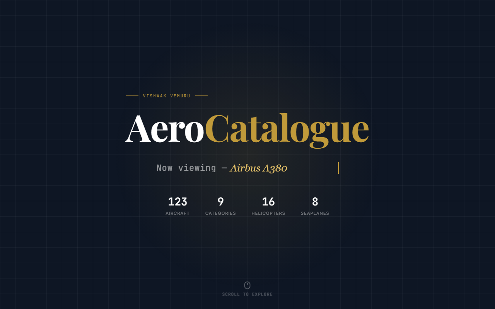

# AeroCatalogue - Aircraft and Helicopters

**A browsable visual catalogue of 123 aircraft.** 9 categories, including 16 helicopters and 8 seaplanes, each with a photo and a link to its Wikipedia page.

**[Open the catalogue](https://vishwakvemuru.github.io/AeroCatalogue/)** - runs in your browser, nothing to install.

## Features
- 123 aircraft with photos, grouped into 9 categories
- Helicopters and seaplanes included
- Detail view with a Wikipedia link for each aircraft
- Single static page: no server, no build step

## Run locally
Download the repo and open `aerocatalogue/index.html` in any browser.

> **Photos:** aircraft photos are gathered from the web and belong to their respective owners. They are included for educational, non-commercial use only. The MIT licence covers the code, not the photos. If you own a photo and want it removed, open an issue and it will be taken down.

## Related
[AeroMatch](https://github.com/VishwakVemuru/AeroMatch) | [Airfoil Bench](https://github.com/VishwakVemuru/Airfoil_Bench) | [Aircraft Classifier](https://github.com/VishwakVemuru/AircraftClassifier)

If this is useful, a star helps others find it.

Built by [Vishwak Vemuru](https://github.com/VishwakVemuru). MIT licence.
